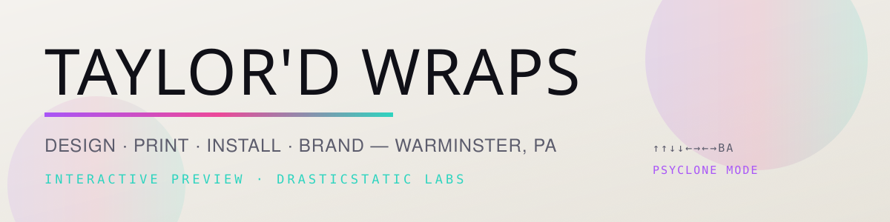

<picture>
  <source media="(prefers-color-scheme: dark)" srcset="public/brand/readme-banner-dark.svg">
  
</picture>

# Taylor'd Wraps · THE CARPORT

> **Where the real thing is being built.** The Next.js era of the Taylor'd Wraps showcase: a long descent from street level to the lab, with a van that wraps itself, a booth that wraps anything, and a counter that ends in a phone call.


---

**Open the Carport →** https://drasticstatic.github.io/taylordwraps-nextjs-preview/
**Next door, the Car Show (the hand-built arcade) →** https://drasticstatic.github.io/taylordwraps-public-preview/

---

## What this is

- A **drasticstatic labs showcase** for [Taylor'd Wraps](https://taylordwraps.com) (vinyl wraps, fleet graphics, color changes, marine graphics; Warminster, PA). Not the shop's live site, and nothing here implies the shop's endorsement until the shop says so.
- **Static, always.** Next.js 16 exported to plain files on GitHub Pages. No checkout, no cart, no payments. The work order ends in an email and a phone call; merch lives on the shop's own storefront.
- **Honest imagery.** Vehicles are placeholder renders except the RC truck, a real photo used with permission. Taylor's real before-and-after photography arrives when she shares it.
- **Icons, not emoji.** Phosphor duotone throughout; the build fails if an emoji sneaks into the HTML.
- **Accessible by default.** Dark and light themes applied before first paint, reduced motion respected, keyboard focus visible, dialogs trap and restore focus.

## The descent

| Floor | What lands there |
| --- | --- |
| Street | The hero: a procedural 3D van you can orbit, wrapping itself in color-flip film |
| Why | The manifesto and the four numbers behind it |
| The receipts | Before-and-after sliders and spec-sheet case files, each with a Wrap Origin hash |
| Visualizer | The booth: fifteen bodies, eight films, three finishes, your own lettering or your own photo |
| Start yours | The counter: four questions to a numbered ticket and an email to the shop |
| The shop | The break room: shop dog, hoodie lore, timelapses |
| The lab | Wrap Origin certificates hashed in your browser; a wallet handshake that unlocks the vault |
| Arrival kit | A welcome in English and Spanish |

Floors still bare metal say so on the page instead of pretending.

## Two lanes, one shop

This repo is **THE CARPORT**. Its sibling **THE CAR SHOW** ([`taylordwraps-public-preview`](https://github.com/drasticstatic/taylordwraps-public-preview)) is the hand-built HTML era kept alive as an arcade: toys, presets, games, and the labs' experiments. A build made in either visualizer travels to the other as a `#build=` link (`public/shared/wrap-spec.schema.json`).

## Private / public split

This repo is a mirror. Source of truth is the private `drasticstatic/taylordwraps` (`carport/`); every push there arrives here as one `sync:` commit, then `.github/workflows/deploy.yml` builds and publishes. Issues and ideas are welcome here; code changes happen upstream.

## Local development

```sh
npm ci
npm run dev                     # http://localhost:3000
NEXT_PUBLIC_BASE_PATH=/taylordwraps-nextjs-preview npm run build   # static export to out/, then tripwire
npm run test:smoke              # Playwright against out/, served like GitHub Pages
```

Stack: Next.js 16 (App Router, static export), React 19, TypeScript, Tailwind 4, framer-motion, Phosphor Icons, three / react-three-fiber / drei for the hero, Playwright for smoke tests. Fonts: Anton, Archivo, JetBrains Mono (self-hosted, OFL).

## License

Code: MIT. Written content: CC BY-SA 4.0 (`LICENSE-CONTENT`). Names and marks: `TRADEMARKS.md`.

---

*Kept by Christopher W ([drasticstatic](https://github.com/drasticstatic)) with Alfred, using Anthropic's Claude Code CLI. Began life as Littlebird's door page.*
